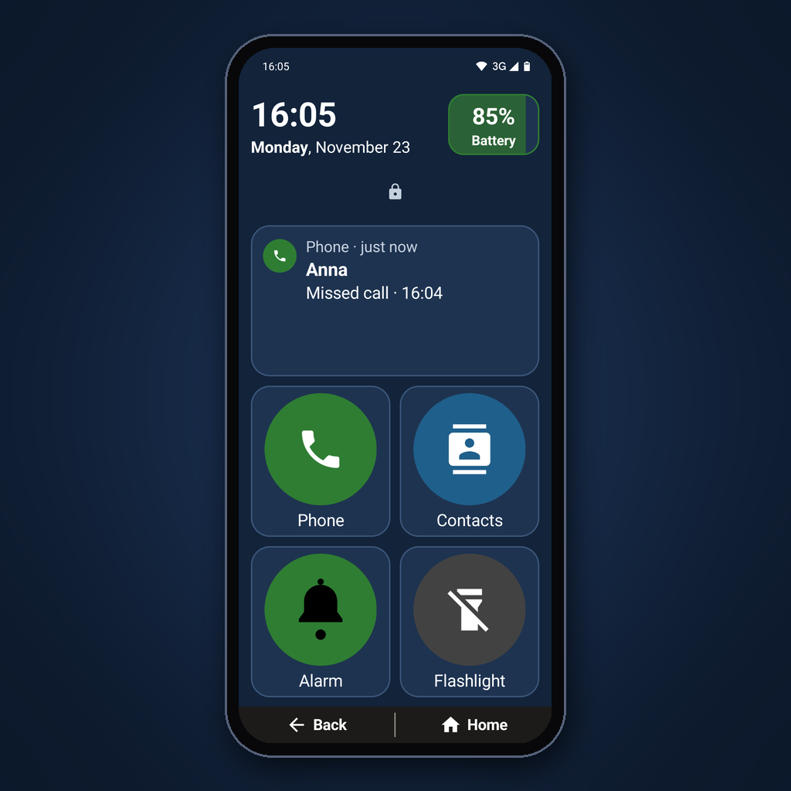

# SeniorPhoneKit

Simple Android apps that turn a phone into one a senior can use: big text,
big buttons, few choices, nothing to swipe. A helper sets the phone up once
and can lock the setup. All apps are free, work offline and come in English
and German.

| App | What it does | Download |
|---|---|---|
| [SeniorLauncher](https://github.com/SeniorPhoneKit/SeniorLauncher) | Home screen: big tiles on pages, widgets, new messages, charging shown clearly | [Latest](https://github.com/SeniorPhoneKit/SeniorLauncher/releases) |
| [SeniorPhone](https://github.com/SeniorPhoneKit/SeniorPhone) | Phone and contacts: big names, favourites, a huge Answer button | [Latest](https://github.com/SeniorPhoneKit/SeniorPhone/releases) |
| [SeniorAlert](https://github.com/SeniorPhoneKit/SeniorAlert) | Alarm clock: a short list of alarms, simple to set and switch | [Latest](https://github.com/SeniorPhoneKit/SeniorAlert/releases) |
| [SeniorLight](https://github.com/SeniorPhoneKit/SeniorLight) | Flashlight: tap on, tap off | [Latest](https://github.com/SeniorPhoneKit/SeniorLight/releases) |
| [SeniorNav](https://github.com/SeniorPhoneKit/SeniorNav) | Big Back and Home buttons over the phone's own navigation | [Latest](https://github.com/SeniorPhoneKit/SeniorNav/releases) |

Each app works on its own; locking the home screen also locks the other apps' settings, and the other apps
make room for SeniorNav's bar. Install by downloading the APK on the phone;
each README has the setup steps for the helper. Needs Android 8.0 or newer.

---

# SeniorPhoneKit (Deutsch)

Einfache Android-Apps, die ein Telefon für Senioren bedienbar machen: große
Schrift, große Tasten, wenige Möglichkeiten, nichts zum Wischen. Eine helfende
Person richtet das Telefon einmal ein und kann die Einrichtung sperren. Alle
Apps sind kostenlos, funktionieren ohne Internet und gibt es auf Deutsch und
Englisch.

| App | Was sie tut | Download |
|---|---|---|
| [SeniorLauncher](https://github.com/SeniorPhoneKit/SeniorLauncher) | Startbildschirm: große Kacheln auf Seiten, Widgets, neue Nachrichten, deutlich sichtbares Laden | [Neueste](https://github.com/SeniorPhoneKit/SeniorLauncher/releases) |
| [SeniorPhone](https://github.com/SeniorPhoneKit/SeniorPhone) | Telefon und Kontakte: große Namen, Favoriten, eine riesige Annehmen-Taste | [Neueste](https://github.com/SeniorPhoneKit/SeniorPhone/releases) |
| [SeniorAlert](https://github.com/SeniorPhoneKit/SeniorAlert) | Wecker: eine kurze Liste, einfach zu stellen und zu schalten | [Neueste](https://github.com/SeniorPhoneKit/SeniorAlert/releases) |
| [SeniorLight](https://github.com/SeniorPhoneKit/SeniorLight) | Taschenlampe: Tippen an, Tippen aus | [Neueste](https://github.com/SeniorPhoneKit/SeniorLight/releases) |
| [SeniorNav](https://github.com/SeniorPhoneKit/SeniorNav) | Große Zurück- und Start-Tasten über der Navigation des Telefons | [Neueste](https://github.com/SeniorPhoneKit/SeniorNav/releases) |

Jede App funktioniert für sich; das Sperren des Startbildschirms sperrt auch die Einstellungen der anderen Apps, und die
anderen Apps machen der Leiste von SeniorNav Platz. Installiert wird durch
Herunterladen der APK auf dem Telefon; jede README beschreibt die Einrichtung
für die helfende Person. Benötigt Android 8.0 oder neuer.
